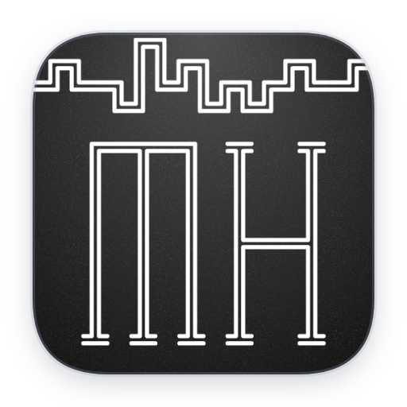

# MultiplayerHub

**Easily create your hostless Minecraft servers — play together without keeping a PC on all day.**

Servers are created and played through the app: whoever comes online hosts it, the others join, and hosting moves along when someone leaves. So when you go to sleep, the server goes with the people still awake.

  

## Download

## Description

- **Free** — no servers to rent, no subscriptions, no premium.
- **Simple UI** — as easy as a game launcher, as capable as a hosting panel.
- **Under-the-hood access** — change server.properties or any other files and settings.
- **No dedicated host** — whoever comes online first hosts the server, everyone joins, and hosting moves along automatically when they leave. No one person has to keep their PC on — play works for as long as anyone wants to play.
- **Invite friends** — every server has a short invite string. A friend pastes it once and can simply connect at any time.
- **Multiple servers** — create as many servers as you like, each with its own world, its own players.
- **Always up to date** — the app keeps itself fresh on its own.
- **Shared modpack** — owner mods and configs can be shared with all players automatically.

## Limitations

Everything runs on your machine, so the only dependency is your **GitHub** and **Zerotier** plans:

- **GitHub:** world repos cap at **5 GB**, so very big and heavily modded worlds will not sync!
- **Zerotier:** free plan holds **10 players** max!

## License

[MIT](LICENSE). Not affiliated with Mojang Studios or Microsoft.
